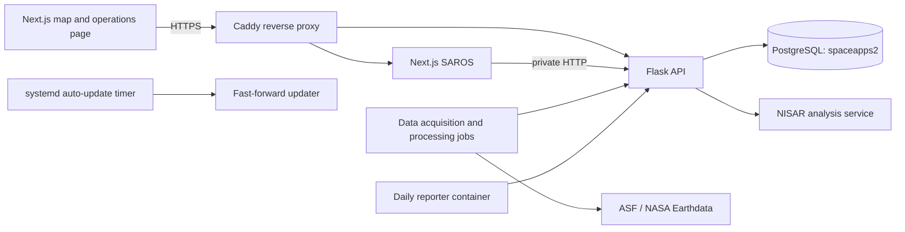

# SAROS System Architecture

## Runtime components

## Data path

1. Catalog searches retrieve available product metadata and spatial footprints.
2. Processing jobs download or extract selected geospatial rasters and record checksums and metadata.
3. A scientifically reviewed processor may produce quality-controlled LOS observations with explicit reference and provenance.
4. The API stores compatible observations and can run a temporal backtest and persist an exploratory LOS target.
5. The composite service screens selected GUNW features and combines relative change with historical impact context.
6. The web application displays the result, territorial exposure, data status, and limitations.

## Production data stores

- `nisar.catalog_assets`: product metadata and spatial coverage.
- `nisar.raster_assets`: references, checksums, and raster metadata; files remain in object or server storage.
- `nisar.observations`: quality-controlled real LOS records and their processing provenance.
- `nisar.forecast_runs` / `nisar.forecasts`: retrospective metrics and persisted LOS forecast targets.
- `hazards.records`: normalized public event and landslide records.
- `territorial.municipal_profiles`: administrative exposure profiles.
- `analysis.composite_assessments`: relative exploratory screening outputs.
- `analysis.operational_snapshots`: scheduled readiness and historical-impact validation reports.

## Runtime boundaries

The browser reaches the public Caddy routes. PostgreSQL and the predictor remain on private Docker networks. NASA acquisition workers receive Earthdata credentials through the server's private environment only. The forecast ingestion and operational refresh routes require the prediction bearer credential.

## Deployment

Docker Compose runs the SAROS web application, Flask API, predictor, and the existing PostgreSQL volume. Caddy is shared with other Orivia applications. The host update timer fast-forwards a clean checkout from `main`, applies new idempotent SQL migrations when their tree changes, then rebuilds application services.
